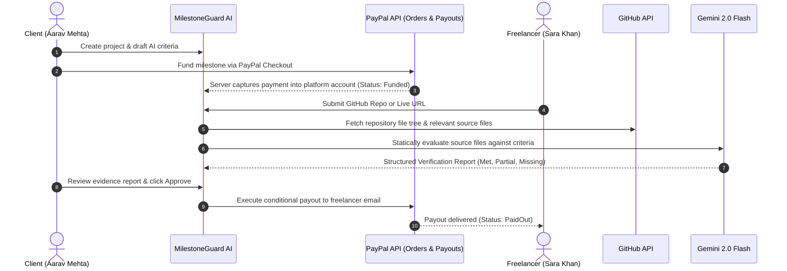

# MilestoneGuard AI

> **"Work gets verified against what was promised. Payments move forward with evidence, not guesswork."**

MilestoneGuard AI is an intelligent, evidence-based milestone payment platform built for the **PayPal AI Hackathon 2026**. It solves the fundamental dilemma of freelance contracts: clients fear paying for incomplete or low-quality work, while freelancers fear delivering work and not getting paid.

With MilestoneGuard AI, clients fund milestones securely via **PayPal Orders v2**. When the freelancer submits their GitHub repository or live URL, **Google Gemini 2.0 Flash** performs static code inspection against agreed acceptance criteria, producing a transparent evidence report with cited source excerpts. Upon client approval, a conditional payout is automatically released to the freelancer via the **PayPal Payouts API**.

---

## ⚠️ Important Payment Notice

> **Milestone-Based Conditional Payment Release (Not Escrow)**  
> MilestoneGuard AI is **not an escrow service** and does not hold funds in a licensed fiduciary escrow trust. Instead, payments are captured into the platform's PayPal merchant account via PayPal Orders v2 upon milestone funding, and subsequently released via the PayPal Payouts API upon verified client sign-off.

---

## Key Features

- **Sequential Milestone Contracts**: Define clear, testable acceptance criteria with AI assistance.
- **PayPal Orders v2 Integration**: Server-side order creation and capture into the platform account.
- **Gemini 2.0 Flash Verification Engine**: Static AST and source code inspection. Every evaluation cites exact file paths and excerpts from the repository snapshot with zero hallucination.
- **Conditional PayPal Payouts**: Automated payouts sent to the freelancer's PayPal email with automated fallback simulation.
- **Transparent Audit Trail**: Immutable event logging for order captures, submissions, verification scores, revision notes, and payouts.
- **Dual-Persona Switcher**: 1-click toggle between **Aarav Mehta** (Client) and **Sara Khan** (Freelancer) stored in session cookies.
- **Mock & Sandbox Modes**: Seamless local demo with zero credentials needed, or full integration with PayPal Sandbox and Gemini APIs.

---

## Architecture & Workflow



---

## Hackathon Highlights

### 1. How PayPal is Used
- **PayPal Orders v2**: Creates intent `CAPTURE` orders with reference IDs linked to database milestones. Amounts are strictly read from the server database, never trusted from the client.
- **Server-Side Capture**: Funds are verified and captured using PayPal OAuth2 tokens into the platform merchant account.
- **PayPal Payouts API**: Automated conditional disbursement directly to the freelancer's PayPal email upon client approval.
- **Webhook Signature Verification**: Listens for `PAYMENT.CAPTURE.COMPLETED` events and verifies cryptographic transmission signatures via `/v1/notifications/verify-webhook-signature`.
- **Mock Mode Fallback**: Provides a complete simulation engine for offline demonstrations and judging without live API credentials.

### 2. How AI is Used
- **AI Acceptance Criteria Drafting**: Gemini assists both parties in turning ambiguous project descriptions into 3–5 objective, testable criteria chips.
- **Static Code Verification**: Gemini inspects the AST file tree and relevant code files (up to 8 prioritized source files, truncated to ~4000 characters).
- **Strict Evidence Citation**: The system prompt forces Gemini to only cite actual lines from the snapshot. Unimplemented criteria are marked `missing`, stubbed logic is marked `partial`, and completed items are marked `met`.
- **Resilient AI Pipeline**: Automatic single-retry on rate limits with domain-aware heuristic fallback to guarantee that the UI never crashes.

### 3. Limitations
- **Static Analysis Only**: Code is analyzed through AST and text extraction; it is not executed inside a runtime sandbox.
- **Simulated Payouts Fallback**: If PayPal Payouts credentials are restricted or unavailable in sandbox accounts, MilestoneGuard marks payouts with a `Simulated Payout` badge for demo integrity.

---

## Tech Stack

- **Framework**: Next.js 14 (App Router) + TypeScript
- **Styling**: Tailwind CSS + Radix UI primitives (shadcn/ui design language)
- **Icons & Polish**: Lucide React, Tabular financial numbers, Inter font
- **Database**: SQLite with Prisma ORM
- **Validation**: Zod (all API endpoints and AI responses)
- **Payments**: PayPal REST API (Orders v2, Payouts, Webhooks) & `@paypal/react-paypal-js`
- **AI Model**: Google Gemini 2.0 Flash via `@google/generative-ai`
- **Testing**: Vitest (State-machine lifecycle and criteria validation tests)
- **Deployment**: Render Web Service (`render.yaml` with auto-migration and auto-seed)

---

## Quickstart Guide

### 1. Clone & Install
```bash
git clone https://github.com/anishagrawal25/milestoneguard-ai.git
cd milestoneguard-ai
npm install
```

### 2. Configure Environment
Copy `.env.example` to `.env`:
```bash
cp .env.example .env
```

| Variable | Description | Default |
| :--- | :--- | :--- |
| `PAYMENT_MODE` | `mock` (zero-credential demo) or `sandbox` | `mock` |
| `PAYPAL_CLIENT_ID` | PayPal Developer Sandbox Client ID | - |
| `PAYPAL_CLIENT_SECRET` | PayPal Developer Sandbox Secret | - |
| `PAYPAL_WEBHOOK_ID` | Optional PayPal Webhook ID | - |
| `NEXT_PUBLIC_PAYPAL_CLIENT_ID`| Public PayPal Client ID | - |
| `PAYPAL_CURRENCY` | Currency code for orders & payouts | `USD` |
| `GEMINI_API_KEY` | Google Gemini API Key | - |
| `GEMINI_MODEL` | Gemini Model Name | `gemini-2.0-flash` |
| `GITHUB_TOKEN` | Optional GitHub PAT for higher API rate limits | - |
| `APP_BASE_URL` | Base URL for webhooks and redirects | `http://localhost:3000` |
| `DEMO_REPO_URL` | Pre-filled sample repo for 1-click submission | `https://github.com/facebook/react` |
| `DATABASE_URL` | SQLite database connection string | `file:./dev.db` |

### 3. Setup Database & Seed
```bash
npx prisma migrate dev --name init
npm run prisma:seed
```

### 4. Run Development Server
```bash
npm run dev
```
Open [http://localhost:3000](http://localhost:3000) in your browser.

---

## How to Get API Keys

### PayPal Sandbox Keys
1. Log in to the [PayPal Developer Dashboard](https://developer.paypal.com/dashboard/).
2. Navigate to **Apps & Credentials** and ensure **Sandbox** is toggled.
3. Click **Create App**, name it `MilestoneGuard`, and copy the **Client ID** and **Secret**.
4. In your sandbox business account settings, ensure the **Payouts** capability is enabled.

### Google Gemini API Key
1. Visit [Google AI Studio](https://aistudio.google.com/app/apikey).
2. Click **Create API Key** and copy the generated key into `GEMINI_API_KEY`.

---

## Demo Walkthrough Script

### Seeded Demo Persona:
- **Client**: Aarav Mehta
- **Freelancer**: Sara Khan (`sb-1nae650838145@business.example.com`)

### Step-by-Step Demo Flow:
1. **Landing Page (`/`)**:
   - Inspect the interactive live preview card showcasing a verified GitHub repository evaluation.
   - Click **Open Dashboard**.
2. **Dashboard (`/dashboard`)**:
   - View count-up stat cards: Total Value, Funded, Awaiting Review, Paid Out.
   - Notice the role switcher in the top right. Switch between **Aarav Mehta (Client)** and **Sara Khan (Freelancer)** to observe how action prompts dynamically change.
3. **Inspect Active Project (`/projects/[id]`)**:
   - Click on the **E-commerce Website** project.
   - Milestone 1 is **Paid Out** ($1,200).
   - Milestone 2 is **AI Verified** ($1,800) and waiting for Client Approval.
   - Milestone 3 is **Created** ($1,000) and unfunded.
4. **Review Verification Report (`/projects/[id]/milestones/[mid]`)**:
   - Open Milestone 2.
   - Examine the **AI Verification Evidence Report**: 60% overall score with 3 Met, 1 Partial, and 1 Missing criterion.
   - Click on each criterion card to inspect the exact file paths and syntax-highlighted code snippets cited by Gemini.
5. **Client Approval & Conditional Payout**:
   - As Aarav Mehta (Client), click **Approve & Release Payment**.
   - Review the confirmation modal and confirm payout.
   - Observe the instant transition to **Paid Out** with the PayPal Payout receipt badge and batch ID.
6. **Freelancer Submission (`Portfolio + Admin Dashboard`)**:
   - Switch to **Sara Khan (Freelancer)**.
   - Navigate to Milestone 1 ("Public Portfolio & Case Study Showcase", funded with $1,500).
   - Click **Use sample repository** to automatically populate the demo repo URL.
   - Click **Run AI Verification** and watch the 4-step progress animation: fetching repository -> reading key files -> checking criteria with Gemini -> generating evidence report.
7. **Reset Demo Data**:
   - Click **Reset demo data** in the footer at any time to restore the initial test state.

---

## Preparing a Sample Repository for Mixed Results

To demonstrate a realistic report with **Met**, **Partial**, and **Missing** criteria:
1. Create a public repository (e.g. `ecommerce-checkout-module`).
2. Add files matching some criteria (e.g., `src/context/CartContext.tsx` with `localStorage` methods for a "Met" score).
3. Add a file with a `// TODO:` comment or partial logic for a second criterion (e.g., `src/lib/discounts.ts` with code discount math but without min-spend checks for a "Partial" score).
4. Leave out any files or references to a third criterion (e.g., invoice PDF generator for a "Missing" score).
5. Submit the repository URL in MilestoneGuard to watch Gemini accurately differentiate each tier.

---

## Running Automated Tests

```bash
npm test
```
Runs the test suite verifying:
- Milestone state-machine lifecycle (Created -> Funded -> Submitted -> Verified -> Approved -> PaidOut and RevisionRequested loops).
- Zod criteria payload validation and score percentage calculation logic.

---

## Deployment on Render

This project includes a native `render.yaml` specification designed for Render's free web tier:
- Automatically executes migrations and seeds the demo database on fresh container start (`scripts/init-db.ts`).
- Build Command: `npm install && npx prisma generate && npm run build`
- Start Command: `npm run start`

---

## License

MIT License. See [LICENSE](file:///Users/dhruvpatil/milestoneguard-ai/LICENSE) for details.
