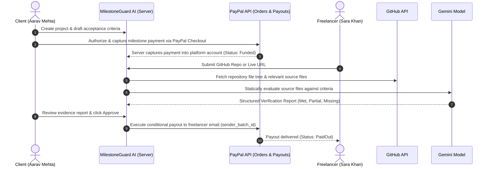

# MilestoneGuard AI

> **"Work gets verified against what was promised. Payments move forward with evidence, not guesswork."**

MilestoneGuard AI is an intelligent, evidence-based milestone payment platform built for the **PayPal AI Hackathon 2026**. It solves the core dilemma of modern freelance contracts: clients fear paying upfront for low-quality or incomplete work, while freelancers fear doing work and not getting paid.

With MilestoneGuard AI, clients fund milestones via **PayPal Orders v2** into the platform's merchant account. When the freelancer submits their GitHub repository or live URL, **Google Gemini** performs static source code analysis against agreed acceptance criteria, producing a transparent evidence report with cited source excerpts. Upon client approval, a conditional payout is released to the freelancer via the **PayPal Payouts API**.

---

## ⚠️ Important Payment Notice

> **Milestone-Based Conditional Payment Release (Not Escrow)**  
> MilestoneGuard AI is **not an escrow service** and does not hold funds in a licensed fiduciary escrow trust. Instead, payments are captured into the platform's PayPal merchant account via PayPal Orders v2 upon milestone funding, and subsequently disbursed via the PayPal Payouts API upon verified client approval.

---

## Key Features

- **Sequential Milestone Contracts**: Define clear, testable acceptance criteria with AI assistance.
- **PayPal Orders v2 Integration**: Server-side order creation and capture into the platform merchant account. Amounts are strictly loaded from the database, never trusted from client payloads.
- **Gemini Code Verification Engine**: Static source code analysis against criteria. Every evaluation cites exact file paths and excerpts from the repository snapshot.
- **Conditional PayPal Payouts**: Automated payouts sent to the freelancer's PayPal email using deterministic batch IDs (`MG_PAYOUT_M_${milestoneId}`) for deduplication.
- **Transparent Audit Trail**: Immutable event logging for order captures, submissions, verification scores, revision notes, and payouts.
- **Server-Side Role Guarding**: Cookie-backed role enforcement preventing cross-role privilege escalation (e.g. freelancers approving their own payouts).
- **Dual-Persona Switcher**: 1-click toggle between **Aarav Mehta** (Client) and **Sara Khan** (Freelancer) stored in session cookies.
- **Mock & Sandbox Modes**: Seamless local demo with zero credentials needed (`PAYMENT_MODE=mock`), or live integration with PayPal Sandbox and Google Gemini APIs (`PAYMENT_MODE=sandbox`).
- **Health & Diagnostic Endpoint**: `/api/health` reports system status, database connectivity, and configuration flags without leaking secrets.

---

## Architecture & Workflow



---

## Hackathon Technical Implementation

### 1. How PayPal is Used
- **PayPal Orders v2**: Creates intent `CAPTURE` orders with reference IDs linked to database milestones. Amounts are strictly validated and loaded from the server database.
- **Server-Side Capture**: Funds are authorized and captured via OAuth2 Bearer tokens from `api-m.sandbox.paypal.com` directly into the platform merchant account.
- **PayPal Payouts API**: Automated conditional disbursement directly to the freelancer's PayPal email upon client approval.
- **Deduplication & Idempotency**: Payouts utilize a deterministic `sender_batch_id` (`MG_PAYOUT_M_${milestoneId}`). On transient network retries, PayPal deduplicates the request and prevents double payouts.
- **Webhook Verification**: Validates incoming PayPal webhook events using `/v1/notifications/verify-webhook-signature` with SHA256 RSA verification.
- **Mock Mode**: Complete offline simulation engine allowing judges and developers to test the full lifecycle without creating sandbox accounts.

### 2. How AI is Used
- **AI Acceptance Criteria Drafting**: Gemini assists both parties in turning ambiguous project descriptions into 3–5 objective, testable criteria chips.
- **Static Code Verification**: Gemini inspects the file tree and key source files (prioritized source files truncated to ~4000 characters).
- **Strict Evidence Citation**: The system prompt forces Gemini to only cite actual lines from the repository snapshot. Unimplemented criteria are marked `missing`, stubbed logic is marked `partial`, and completed items are marked `met`.
- **Configurable Model**: The AI model is configured via `GEMINI_MODEL` (defaults to `gemini-3.5-flash`).
- **Resilient AI Pipeline**: Automatic retry on rate limits with domain-aware heuristic fallback so the application never crashes.

### 3. System Limitations
- **Static Analysis Only**: Code is analyzed through static inspection of repository contents (file tree and key source files); code is not executed in a runtime sandbox or VM.
- **Sandbox Environment Only**: Intended for PayPal Sandbox testing and hackathon evaluation; production deployment requires standard PayPal compliance approvals.
- **Simulated Payout Fallback**: When PayPal Sandbox accounts lack Payouts API permissions, the system tags the transaction with a `Simulated Payout` badge to preserve demo flow without masking status.

---

## Tech Stack

- **Framework**: Next.js 14 (App Router) + TypeScript
- **Styling**: Tailwind CSS + Radix UI primitives (shadcn/ui design language)
- **Design System**: Inter font, 8px grid scale, WCAG AA contrast, tabular financial numbers (`tabular-nums`)
- **Database**: SQLite with Prisma ORM
- **Validation**: Zod (all API endpoints, AI responses, and webhook payloads)
- **Payments**: PayPal REST API (Orders v2, Payouts, Webhooks) & `@paypal/react-paypal-js`
- **AI Model**: Google Gemini (`GEMINI_MODEL`, default `gemini-3.5-flash`) via `@google/generative-ai`
- **Testing**: Vitest (Milestone state-machine, action guards, and Zod request schemas)
- **Deployment**: Render Web Service (`render.yaml` with auto-migration and auto-seed)

---

## Quickstart Guide

### 1. Clone & Install
```bash
git clone https://github.com/anishagrawal25/milestoneguard-ai.git
cd milestoneguard-ai
npm install
```

### 2. Configure Environment
Copy `.env.example` to `.env`:
```bash
cp .env.example .env
```

| Variable | Description | Default |
| :--- | :--- | :--- |
| `PAYMENT_MODE` | `mock` (zero-credential demo) or `sandbox` | `mock` |
| `PAYPAL_CLIENT_ID` | PayPal Developer Sandbox Client ID | - |
| `PAYPAL_CLIENT_SECRET` | PayPal Developer Sandbox Secret | - |
| `PAYPAL_WEBHOOK_ID` | Optional PayPal Webhook ID | - |
| `NEXT_PUBLIC_PAYPAL_CLIENT_ID`| Public PayPal Client ID for JS SDK | - |
| `PAYPAL_CURRENCY` | Currency code for orders & payouts | `USD` |
| `GEMINI_API_KEY` | Google Gemini API Key | - |
| `GEMINI_MODEL` | Gemini Model Name | `gemini-3.5-flash` |
| `GITHUB_TOKEN` | Optional GitHub PAT for higher rate limits | - |
| `APP_BASE_URL` | Base URL for webhooks and redirects | `http://localhost:3000` |
| `DEMO_REPO_URL` | Pre-filled sample repo for 1-click submission | `https://github.com/anishagrawal25/dockerized-react-app` |
| `DATABASE_URL` | SQLite database connection string | `file:./dev.db` |

### 3. Setup Database & Seed
```bash
npx prisma migrate dev --name init
npm run prisma:seed
```

### 4. Run Development Server
```bash
npm run dev
```
Open [http://localhost:3000](http://localhost:3000) in your browser.

---

## Health Check Endpoint

Navigate to `GET /api/health` to verify system diagnostics:
```json
{
  "status": "healthy",
  "timestamp": "2026-11-12T12:00:00.000Z",
  "paymentMode": "mock",
  "database": "connected",
  "env": {
    "PAYPAL_CLIENT_ID": false,
    "PAYPAL_CLIENT_SECRET": false,
    "PAYPAL_WEBHOOK_ID": false,
    "NEXT_PUBLIC_PAYPAL_CLIENT_ID": false,
    "GEMINI_API_KEY": false,
    "GITHUB_TOKEN": false
  }
}
```

---

## Demo Walkthrough Script

### Seeded Personas
- **Client**: Aarav Mehta
- **Freelancer**: Sara Khan (`sb-1nae650838145@business.example.com`)

### Step-by-Step Flow:
1. **Landing Page (`/`)**:
   - Inspect the interactive live preview card showcasing a verified repository evaluation.
   - Click **Open Dashboard**.
2. **Dashboard (`/dashboard`)**:
   - View stat cards: Total Value, Funded, Awaiting Review, Paid Out.
   - Use the role switcher in the header to toggle between **Client** and **Freelancer** personas.
3. **Inspect Active Project (`/projects/[id]`)**:
   - Click on the **E-commerce Website** project.
   - Milestone 1 is **Paid Out** ($1,200).
   - Milestone 2 is **AI Verified** ($1,800) and waiting for Client Approval.
   - Milestone 3 is **Created** ($1,000) and unfunded.
4. **Review Verification Report (`/projects/[id]/milestones/[mid]`)**:
   - Open Milestone 2.
   - View the top action banner and horizontal status stepper.
   - Inspect the **Evidence Report**: 60% overall score with 3 Met, 1 Partial, and 1 Missing criterion, citing exact file paths and code snippets.
5. **Client Approval & Conditional Payout**:
   - As Aarav Mehta (Client), click **Approve & Release Payment**.
   - Confirm the release in the modal.
   - Status updates instantly to **Paid Out** with receipt details and deterministic batch ID.
6. **Freelancer Submission (`Portfolio + Admin Dashboard`)**:
   - Switch to **Sara Khan (Freelancer)**.
   - Navigate to Milestone 1 ("Public Portfolio & Case Study Showcase", funded with $1,500).
   - Click **Use sample repository** to populate the demo repo URL.
   - Click **Run AI Verification** to watch the animated 4-step progress: fetching repo -> reading files -> evaluating criteria -> generating evidence report.
7. **Reset Demo Data**:
   - Click **Reset demo data** in the footer at any time to re-seed the initial test state.

---

## Running Automated Tests

```bash
npm test
```
Executes the Vitest suite covering:
- **Milestone State Machine**: Legal transitions, all illegal transitions, and action guard preconditions.
- **Criteria & Scoring**: JSON schema validation, status boundaries, and score percentage calculations.
- **Zod Request Schemas**: Project creation, payment capture, orders, submissions, and revisions.

---

## License

MIT License. See [LICENSE](file:///Users/dhruvpatil/milestoneguard-ai/LICENSE) for details.
